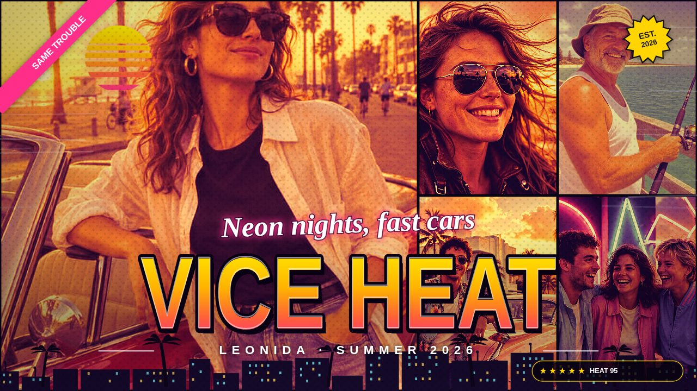

# Vice Coast Cover Studio 4

An entry for [Make GTA 6 Cover Art](https://make.fun/bounty/gta6-cover-art-01) — a
web app that turns your photos into GTA-style multi-panel poster cover art, in
the spirit of the GTA 6 posters, with entirely original art and lettering.

## What it does

Open `app/index.html` (or run `node serve.ts` and open http://localhost:8080) and
a finished cover is already on screen — eight sample photos auto-load into a
people-forward hero layout, graded Vice Sunset, with the giant overlapping
title. From there:

- **Any photo**: upload your own photos (they never leave your machine — the
  app is 100% offline), click a panel to select it, drag to reframe, scroll to
  zoom, or nudge with the arrow keys. Fill all panels with one photo, or span
  one photo across every panel like a window.
- **6 layouts**: Hero Left, Hero Right, Hero Top, Grid 3×3, Film Strips, and
  Vice Slash — slanted diagonal panels with a hero in the middle.
- **6 colour grades**: Vice Sunset, Neon Nights, Golden Hour, Teal & Orange,
  Poster Ink, Clean Photo — real gradient-map grades applied per pixel, plus a
  posterize option and per-panel grade overrides.
- **Enhance**: one-click auto-enhance with five sliders (brightness, contrast,
  saturation, sharpness, warmth) and three presets — Golden Hour, Neon Pop,
  Clean & Bright. Sharpening is a real unsharp mask, and Enhance applies to the
  preview and the export alike.
- **Lettering**: a giant condensed gradient title (yellow → orange → pink,
  thick black outline, hard shadow) overlapping the photos, a script subtitle,
  a letterspaced caption band, a corner ribbon, a heat meter (1–5 stars), plus
  title-size and subtitle-size sliders and a top/bottom caption position
  toggle.
- **Poster layers**: retro striped sun, sunburst rays, skyline and palm
  silhouettes, speed lines, halftone dots, film grain, vignette, a yellow
  "EST. 2026" starburst sticker, and the heat pill — each toggleable.
- **Fast and easy**: three post sizes (1920 × 1080, 1080 × 1080, 1080 × 1350),
  one-click Export PNG, an Export-all-3-sizes button, hold-to-Compare against
  the original photos, and keyboard shortcuts (1–6 layouts, G grade, E enhance,
  D decorations, X export, C compare).
- **Deterministic**: every grain dot, skyline tower and speed line comes from a
  seeded generator — the same cover always renders the same pixels.

All artwork is original: no Rockstar Games logo, artwork, character or font.
The sample photos are the kit's two free-to-use photos plus six made with an
image model. Only system fonts are used — nothing loads over the network.

## How this entry meets the rubric

1. **The art** — the default cover is people-forward (a smiling woman in a
   convertible fills the hero panel), with five distinct photos, a strong
   gradient-map sunset grade, halftone and grain, a retro sun and skyline, and
   a giant gradient title overlapping the photos with a script subtitle, a
   caption band, a starburst sticker, a ribbon and a star heat pill.
2. **Any photo** — uploads from your machine, per-panel crop (drag), position
   (arrow keys), zoom (scroll or slider), per-panel grade, fill-all and
   one-photo-across-all-panels modes, and full caption editing.
3. **Fast and easy** — a finished cover loads with zero steps; one click
   exports a PNG in any of the three common post sizes, or all three at once.
4. **Polish** — a live preview with a clear dark editor, well-made lettering
   with size and position controls, and ten toggleable poster effects.

## Smoke tests

Open the app with `?test=1` — it runs 20+ in-page checks (all photos load, all
layouts and grades render, Enhance/posterize/decorations/title controls change
the preview, per-panel grade/zoom/reframe work, compare and span modes work,
exports in all three sizes, deterministic re-renders) and writes the report
into `#test-report`.

## Screenshots

`?shot=cover` renders the cover full-bleed for a screenshot (with `size`,
`layout`, `grade`, `title`, `script`, `tagline`, `ribbon`, `heat`, `photo`,
`hero`, `span`, `posterize`, `caption`, `titlesize` and `scriptsize` params);
`?shot=editor` shows the editor with a photo loaded.

## License

MIT — see [LICENSE](LICENSE).
